# FLIPPO (كان اسمها FLIPNOVA)

**اركض. اقلب الجاذبية. غيّر العالم.**

لعبة أركيد ثنائية الأبعاد بستايل Pixel Art، مبنية بالكامل من «وثيقة الرؤية» (17 صفحة).
ضغطة واحدة تقلب الجاذبية بين الأرض والسقف **وتبدّل العالم** بين الأزرق والبنفسجي (Dual Flip).
بدون موسيقى نهائيًا: كل الأصوات مؤثرات مولّدة لحظيًا (هواء، نقرات، نبضات رقمية، طقطقة).

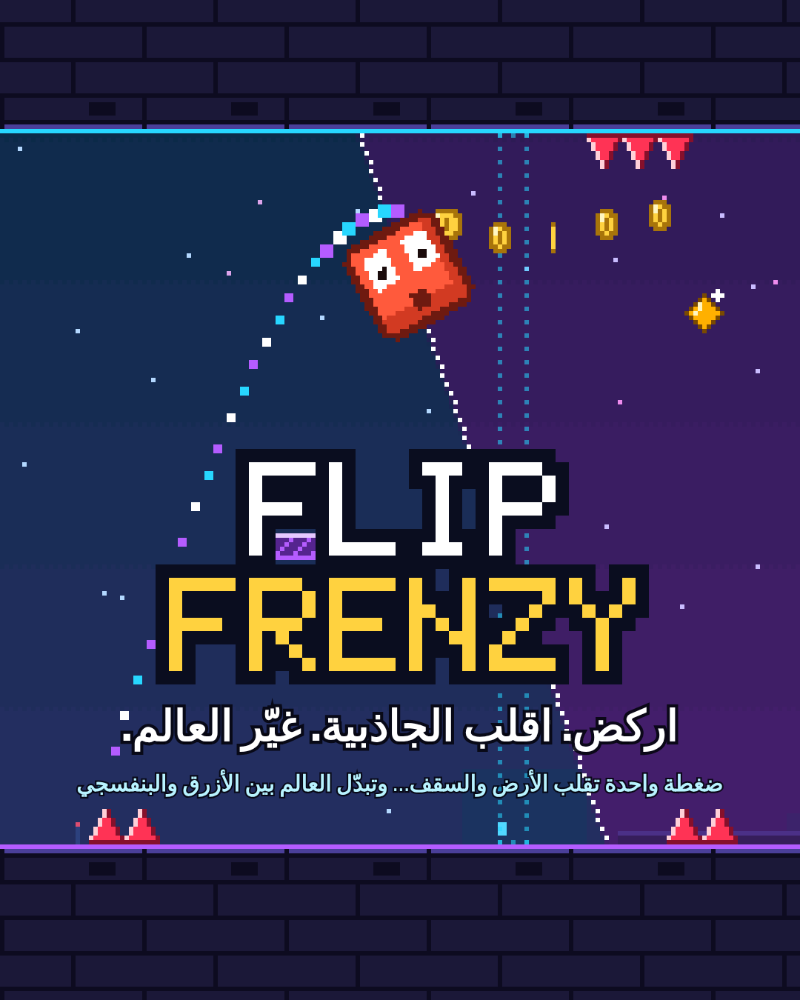

## التشغيل

- **أندرويد (APK):** نزّل [`dist/Flippo.apk`](dist/Flippo.apk) (بيلد 66 / 14.1) على الموبايل وثبّته (فعّل «التثبيت من مصادر غير معروفة» لو طلب). اللعبة بالعرض، بملء الشاشة، وتعمل بدون إنترنت.
  - **لو عندك نسخة قديمة متسطبة:** النسخة دي متمضية بمفتاح تاني، فمش هتتسطب فوقها. انقل تقدّمك الأول: الإعدادات ← 💾 تقدّمك ← نسخ، وبعدين امسح القديمة، وسطّب الجديدة، واعمل استرجاع بنفس الكود.
- **المتصفح من غير تسطيب:** افتح [`dist/Flippo.html`](dist/Flippo.html) (ملف واحد).
- **المتصفح:** افتح `index.html` مباشرة. على الموبايل لفّه بالعرض.
- **التحكم:** اللمس في أي مكان أو `Space` / `↑` للقلب، و`Esc` / `P` للإيقاف المؤقت. زر الرجوع في أندرويد يوقف اللعب مؤقتًا.

## الصور المتخيَّلة (Concept Art)

| | |
|---|---|
| 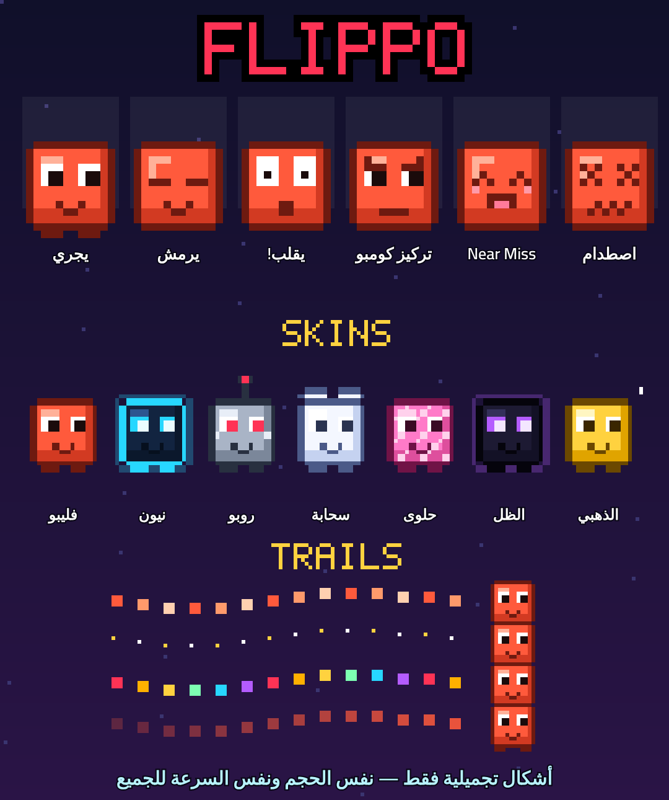 | 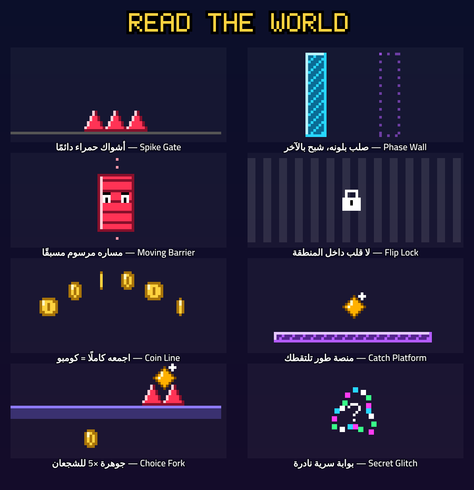 |
| 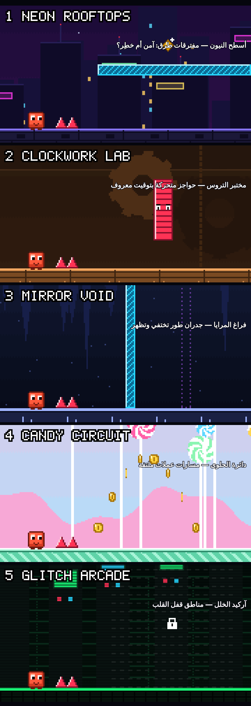 | 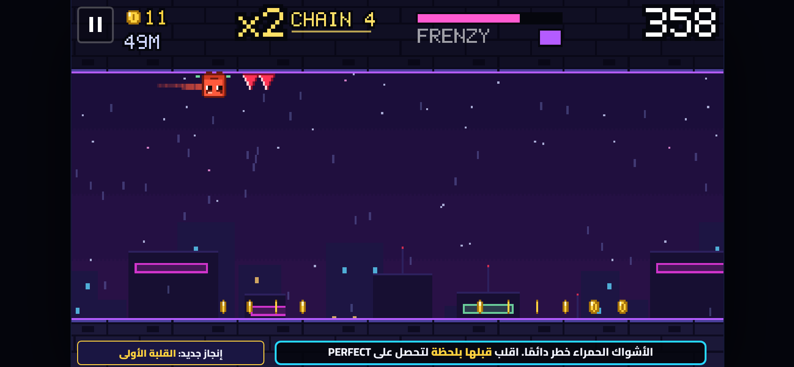 |
| 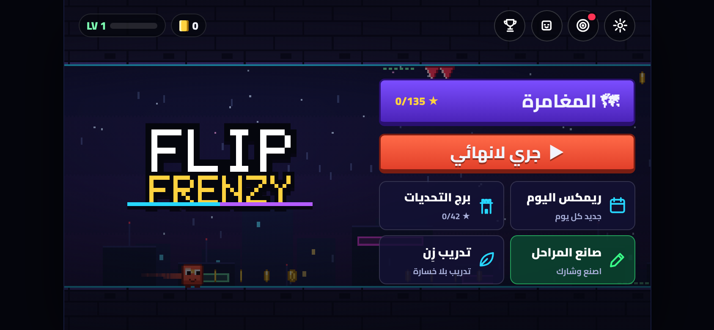 | 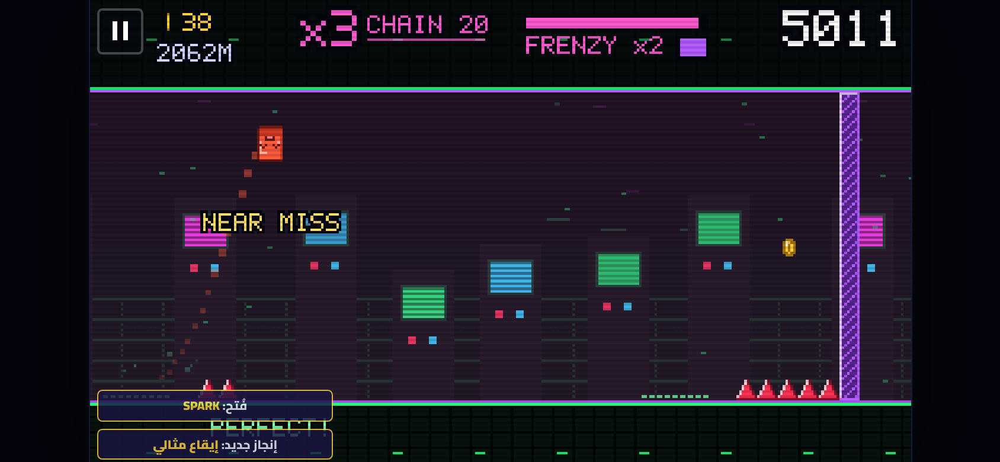 |

كل الصور مرسومة بنفس كود الـPixel Art الذي تستخدمه اللعبة (`tools/concept.html`)، لذلك ما تراه في الصور هو بالضبط ما تراه في اللعب.

## ما الموجود في اللعبة

**الفكرة الأساسية — Dual Flip:** العالم الأزرق = الجاذبية للأسفل، البنفسجي = للأعلى. الجدران والمنصات الملوّنة صلبة فقط في عالمها، فكل قلبة قرار مزدوج: «أين سأقف؟» و«ما الذي سيصبح صلبًا؟».

**المهارات (من التوقيت لا من الأزرار):**
- **Perfect Flip** — اللعبة تحاكي المستقبل لحظة الضغط: لو كنت ستصطدم خلال ربع ثانية ونجوت بالقلب = Perfect. علامات خضراء على الأرض تريك النافذة للمبتدئين.
- **Near Miss** — المرور على بعد أقل من 5 بكسل من الخطر.
- **Clean Line** — جمع خط العملات كاملًا. بعض الخطوط ترسم مسار القلبة المثالية بالضبط (اللعبة تعلّمك التوقيت).
- **Combo** ×1 → ×2 → ×3، يهبط تدريجيًا بدل عقوبة مفاجئة.
- **Frenzy** — 6 ثوانٍ: نقاط ×2 وجذب للعملات وألوان أقوى.
- **Flip Echo** — بعد 3 Perfect متتالية تظهر ظلال لمسارك.

**العقبات (10 أنواع، كلها مقروءة قبل الالتزام):** أشواك، جدران الطور، الكسّار المتحرك (خط حركته مرسوم)، منطقة قفل القلب، منصة الطور «الماسكة»، مفترق الطرق (ممر آمن وممر خطِر بجواهر ×5)، خطوط عملات، بوابة «?» سرية نادرة، وجديد في v2:
- **لوحة القفز** — تقلبك تلقائيًا، وعليك تجهيز قلبة العودة.
- **بوابة الليزر** — شعاع يبدّل بين النصف العلوي والسفلي بإيقاع ثابت ويومض قبل التبديل، مع فجوة أمان مضمونة.

**5 عوالم** تتبدل كل 500م، لكل عالم شكل وعقبة مميزة: أسطح النيون، مختبر التروس، فراغ المرايا، دائرة الحلوى، آركيد الخلل.

**الأنماط:** الجري اللانهائي · ريمكس اليوم (مرحلة ثابتة يوميًا + ظلّك يسابقك) · برج التحديات (6 قطاعات × تحديين، 3 نجوم لكل تحدٍ) · تدريب زِن (بلا خسارة).

**جديد في v6 — ♛ التحدي الأسطوري + الطيران + عدالة حقيقية:**
- ~~**طريق الأسطورة**~~ — **اتشال في بيلد 36.** الإنجازات (ربع/نص/قربت/♛ أسطورة)، وشخصية LEGEND، والأثر الذهبي، وعلامة ♛ بقوا بييجوا من نجوم المغامرة، واللي كسبهم قبل كده بيفضلوا معاه.
- **الطيران:** بوابة طيران بتحوّلك لصاروخ — اضغط مطوّل تطلع، سيب تنزل — في أنفاق متعرّجة. موجود في 17 مرحلة مغامرة، والجري اللانهائي، وصانع المراحل.
- **السرعة بتزيد فعلًا:** كل مرحلة مغامرة بتسرع 25% من أولها لآخرها، والجري اللانهائي بقى أسرع (~132 عند 500م، ~155 عند 1كم)، مع خطوط سرعة على الشاشة و«SPEED UP!» كل مرحلة.
- **مفيش حاجة مستحيلة:** اختبار جديد `tools/human-test.js` — بوت «بشري» بيضغط بخطأ توقيت عشوائي ±40ms زي الإيد الحقيقية. **مراحل المغامرة بتعدّي 3 من 4 محاولات على الأقل.** اتصلّح بسببه: سلم الأطوار، الجدار بعد الأشواك (بقى «اقلب، انزل، اقلب»)، النسيج (فيه حفرة آمنة تحت كل أشواك سقف)، فجوة أمان الليزر، قاعة المناشير (بقت قابلة للحل بالتصميم)، موجة الكسّارات، والنطّاطات (بقت بتتحسب بالضبط بأي سرعة).

**جديد في v5 — المغامرة: 45 مرحلة متصممة بالإيد:**
- **9 عوالم × 5 مراحل.** كل عالم بيعلّمك ميكانيكيته في المرحلة 1، يخلطها في 2–4، ويختم بـ**«تحدي»** طويل وصعب (المرحلة 5). المرحلة الأخيرة **«القمة»** فيها كل حاجة: ~10,000 بكسل و7 أعلام حفظ.
- **قطع تصميم خاصة بالمغامرة:** سلم الأطوار، النسيج (Weave)، موجة الكسّارات، إيقاع الشوك القافز، قاعة المناشير، صف البندول، تتابع المصاعد، سلسلة المراوح، ورسومات بالعملات.
- **أعلام حفظ (Checkpoints):** لو مُت ترجع لآخر علم — العملات اللي جمعتها بتفضل معاك.
- **3 نجوم لكل مرحلة:** خلّصها ★ اجمع كل العملات ★ بدون ولا موتة ★ (135 نجمة). مكافآت عملات لأول مرة ولكل نجمة جديدة.
- **كل المراحل الـ45 اتلعبت بالبوت** (`node tools/campaign-test.js`) — كلها قابلة للعبور.
- إنجازات جديدة: المغامر، بلا خدش، على القمة.

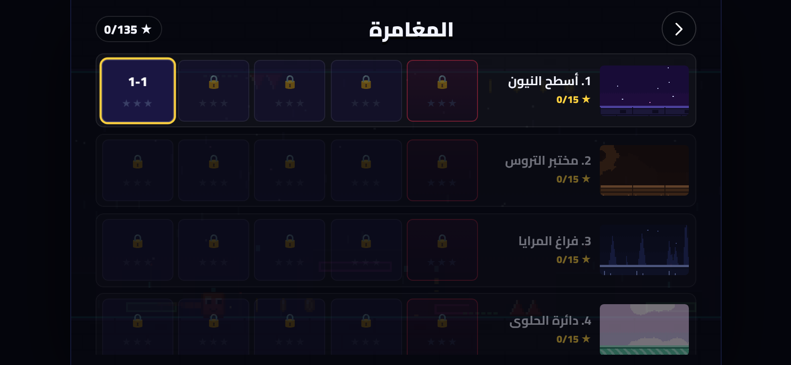

**جديد في v4:**
- **5 منصات قفز جديدة:** مصعد متحرك، منصة هشّة بتتكسر، جسر وامض، ممر نطّاطات (pinball)، مروحة هوا، وبوابة تسريع.
- **5 عقبات جديدة:** منشار رايح جاي، شوك قافز على إيقاع، كرة دوّارة، بندول، وسرعات أعلى.
- **4 عوالم جديدة (9 عوالم):** قلب البركان، أعماق المحيط، معبد السماء، القمم المتجمدة — مع **انتقال بكسلي** بين العوالم ومسح بكسلي بين الشاشات.
- **واجهة جديدة أنضف:** شاشة رئيسية بأيقونات، عداد نقاط في النص، ونتيجة مختصرة.
- **لوحة الشرف:** أفضل جولاتك، أرقام اليوم، البرج والإنجازات — باسمك وشخصيتك.
- **صانع المراحل اتعمل من جديد:** الأدوات في 3 أقسام، الضغطة بتحط على طول، السحب بيرسم صف كامل، أسهم وشريط للتنقل، و5 مراحل مختارة.
- **5 شخصيات بأشكال مميزة وأصعب في الفتح:** GLOOP، ZORP، SHINOBI (المرحلة 8)، BOO (المرحلة 10)، SIR FLIP (30 نجمة).
- قطاع برج جديد **سيرك السماء** (14 تحدي).

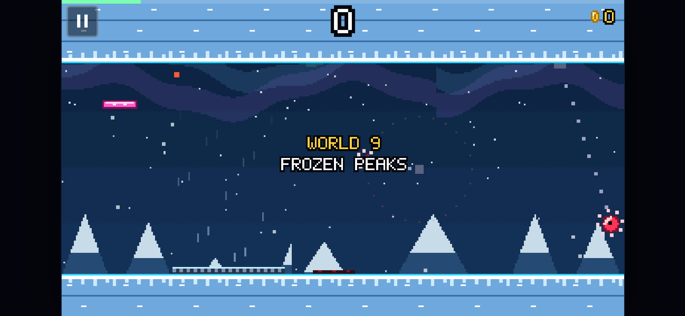

**جديد في v3 — اللعبة بتكبر معاك:**
- **مراحل (Stages)** كل 400م: لافتة «STAGE n» ومكافأة عملات ونقاط تكبر كل مرة.
- **مفاجآت المراحل** من المرحلة 3: جاذبية خفيفة، جاذبية تقيلة، تيربو، عملات ×2، أو ممرات أضيق.
- **Overdrive** بعد 2.5كم: السرعة تفضل تزيد والعقبات تقرب من بعض (مع حد أقصى عادل، مُختبر بالبوت حتى 4.5كم).
- **صانع المراحل:** 15 أداة (شوك، جدران، صناديق، رفوف، منصات، كسّار، ليزر، قفّاز، قفل، عملات، جواهر، النهاية، ممحاة)، 5 عوالم و4 سرعات، تجربة من البداية أو «من هنا»، تراجع، والبوت يتأكد إن مرحلتك قابلة للعبور.
- **مشاركة المراحل بكود** نصي قصير، واستيراد مراحل صحابك.
- **3 مراحل مختارة** تقدر تلعبها أو تعمل لها **ريمكس**.
- إنجازات جديدة: «صانع المراحل» و«المرحلة العاشرة».

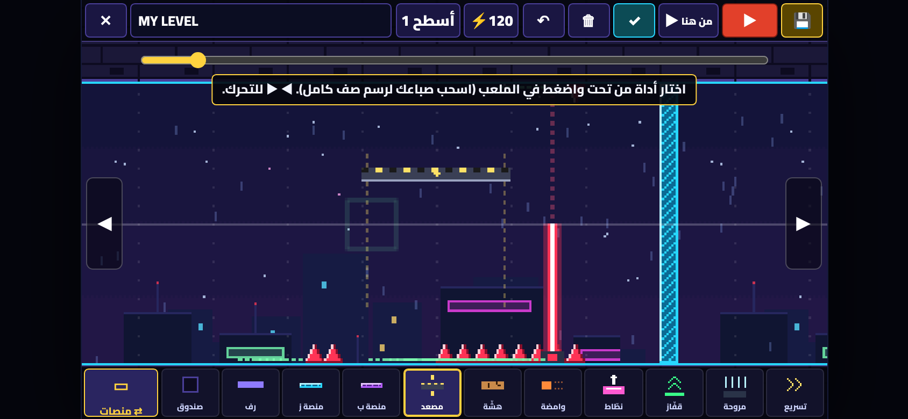

**جديد في v2:**
- **اللعب بالعرض** — رؤية أوسع للأمام = وقت أكثر لقراءة الخطر.
- **مهام يومية** — 3 مهام جديدة كل يوم بمكافآت عملات، و+100 لو أنهيتها كلها.
- **مستوى اللاعب (XP)** — كل جولة تعطي خبرة، والمستويات تفتح أشكالًا جديدة.
- **لحظة تصوير بطيء** قصيرة عند Perfect وNear Miss.
- **طقس لكل عالم:** مطر النيون، شرر التروس، لمعان المرايا، رشّات الحلوى، بتات الخلل.
- **شخصيات جديدة:** MEOWPO القطّ، PHOENIX (المستوى 8)، وأثر COMET (المستوى 5).
- قطاع برج جديد **مختبر الجاذبية**.

**التقدّم العادل:** 9 شخصيات و6 آثار حركة — كلها تجميلية فقط (نفس الحجم والسرعة)، تُفتح بالعملات أو الإنجازات أو المستوى. لا صناديق حظ ولا إعلانات ولا شراء قوة. 14 إنجازًا.

**شاشة النتيجة** تشرح سبب الخسارة («الجدار الأزرق صلب في العالم الأزرق — اعبره وأنت بنفسجي»)، أفضل حركة، وزر «العب مجددًا» كبير. زر **مشاركة** يصنع بطاقة نتيجة كصورة.

**الإعدادات:** حجم المؤثرات وأصوات الواجهة منفصلين، كتم، اهتزاز، تقليل الوميض والاهتزاز، علامات التوقيت، مكان زر الإيقاف (يمين/يسار)، العربية/English.

## v8.2

- **لوحة العالم:** أي رقم بيتعاد صح بيظهر مهما كانت نسخة اللعبة اللي اتسجل بيها. قبل كده كل تحديث كان بيخفي الأرقام القديمة. الرقم القديم اللي مبقاش بيتعاد بيستخبى بهدوء من غير ما يتحسب مزيف.
- الاختبارات الآلية مبقتش بتبعت أرقام للوحة الحقيقية.
- **الجري اللانهائي بقى أصعب وأسرع:**
  - السرعة بتبدأ من 112، وبتزيد 11 كل مرحلة (300م)، لحد 200 على 2.4 كم وبعدها 212.
  - أقصى صعوبة على 1.8 كم، وفترات راحة أقل.
  - كل إثبات بيفتكر قواعد نسخته، فالأرقام القديمة بتتعاد بقواعدها وبتفضل في لوحة العالم.
- **المنصة الهشّة بتكبر مع السرعة:** الوقت اللي محتاجه يفضل زي ما هو. كانت على السرعات العالية بتحتاج ضغطتين في أقل من 0.3 ثانية.
- **اختبار جديد:** `human-test --endless` بيلعب جولات لانهائية كاملة لحد 3.2 كم. لقى إن الانتقال بين العقبات كان ظالم في 4 من 8 جولات، حتى بالقواعد القديمة، واتصلح.
- **اللعبة بقت إنجليزي:** والعربي لسه موجود في الإعدادات.
- **نسخة الكمبيوتر:** `bash tools/build-web.sh` بيطلّع `dist/Flippo-web.zip`. تفكه وتفتح `index.html`.
- **هدايا من السيرفر من غير تحديث:** ارسم سكن وأثر حركة في `dist/gift-maker.html` («صانع الهدايا»)، واختار كود، وانسخ سطر SQL والصقه في Supabase. الكود يشتغل في اللعبة على طول. الأكواد بتتحفظ على السيرفر مشفّرة (sha256)، والجدول مقفول، وأي هدية بتتراجع قبل ما تترسم: ألوان وبكسلات وتأثيرات معروفة بس. الإعداد مرة واحدة: `tools/supabase-gifts.sql`.
- **أكواد هدايا شخصية:** كل كود بيفتح سكن وأثر خاصين. أول كود سكن هاكر **Y0U55EF** وأثر **MATRIX**، والتاني ساحر أبيض الشعر **GHONEIM ∞** بعصابة وكورتين أزرق وأحمر، وأثر **INFINITY**. الأكواد نفسها مش مكتوبة في الكود المصدري، الموجود بس بصمتها.

## v8.1 — مراجعة عدالة شاملة 🔍

- **باج كبير اتصلح:** في المغامرة ووضع التدريب في الأسطورة، اللعبة كانت بتمسح المنصات اللي ورا الكاميرا عشان الأداء. فلما تموت وترجع للعلم، كنت بترجع لمرحلة **منصاتها ممسوحة** والأشواك بس اللي فاضلة، وده كان مستحيل. دلوقتي مفيش أي حاجة بعد آخر علم بتتمسح، وفي وضع Zen كمان.
- الرجوع للعلم بقى بيلغي الطيران لو كنت مت وانت طاير.
- **المنصات الرفيعة** (الماسكة، المصاعد، الهشّة، الرفوف) مبقتش بتموّتك لو خبطت في حرفها. بتتزق للناحية الأقرب.
- **البندول:** الأشواك اللي بعده اتبعدت، عشان تقدر تغيّر الحارة من غير ما تعدّي قدام الكورة.
- **اختبار «اللاعب البشري» بقى أصعب بكتير:**
  - مبيقدرش يضغط مرتين ورا بعض في أقل من 0.3 ثانية.
  - بيختار الطريق المريح زي الإنسان.
  - بيتجرب من **كل علم** كأنك لسه راجع بعد ما مت، في لحظة عشوائية.
  - بيتجرب على كل عقبة في اللانهائي بسرعة 120 وبأقصى سرعة 205.
  
  كله عدّى.

## الجديد في v8 — البوابات السرية والمكابس 🌀

| | |
|---|---|
| 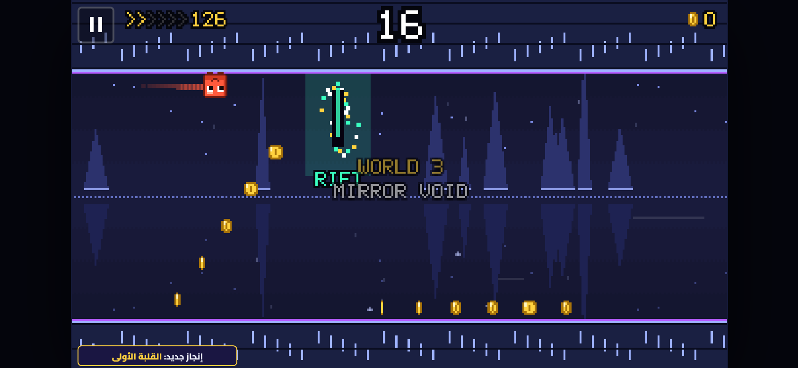 | 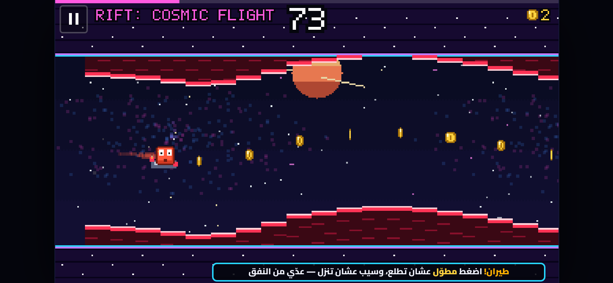 |
| 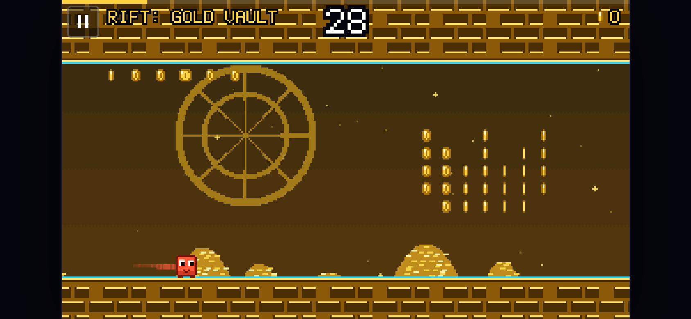 | 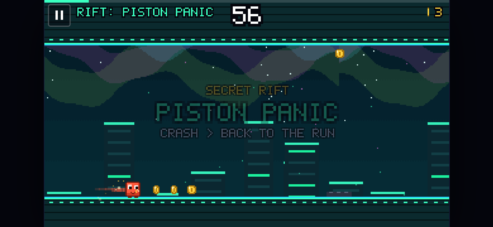 |
| 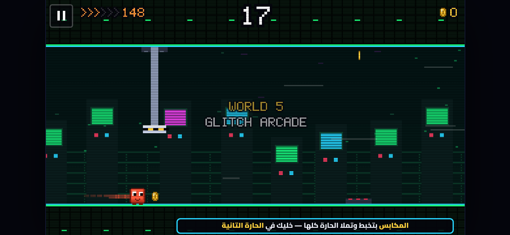 | 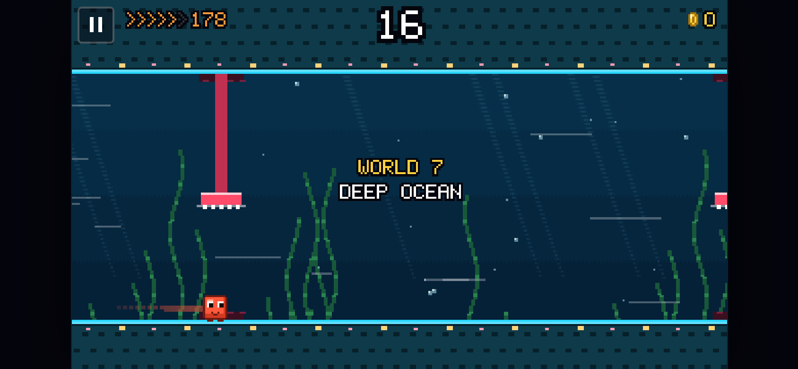 |
| 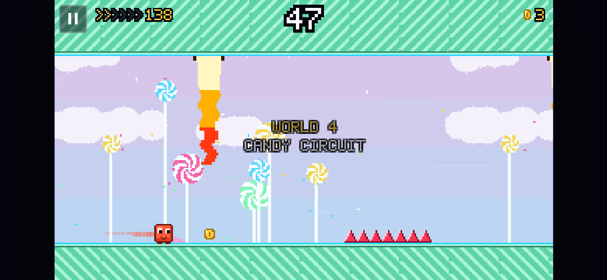 | 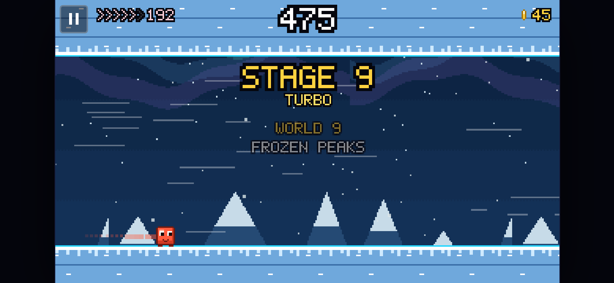 |

- **بوابات RIFT ✦** في الجري اللانهائي والريمكس: بوابة بتلف في حارة السقف كل مرحلتين. اقلب لفوق وادخلها، وهتتنقل **لعالم سري مؤقت** وبعدين ترجع لنفس المكان في الجري:
  - **COSMIC FLIGHT:** طيران في الفضاء بين الكواكب.
  - **GOLD VAULT:** خزنة مليانة دهب، رسومات من العملات ونطّاطات.
  - **PISTON PANIC:** مصنع الشفق مليان مكابس.
  
  لو خلصت العالم السري تاخد **مكافأة كبيرة** (+800 نقطة + عملات) وإنجاز «عابر البوابات». ولو وقعت جواه **مش بتخسر**، البوابة بس بترجعك للجري. ولو مدخلتهاش بتكمل عادي على عملات الأرض.
- **عقبات بتطلع وتدخل وبتقتل:**
  - **المكابس:** بتخبط من الأرض أو السقف وتملا الحارة كلها، بس الحارة التانية دايمًا آمنة.
  - **الفكوك:** فك فوق وفك تحت بيقفلوا بالدور، ومحسوبين زي الليزر بالظبط، فدايمًا في ناحية آمنة.
  - **نافورات النار:** بتطلع من فتحات، وبينها أشواك بتخليك تلف بين الناحيتين.
  
  كلهم بيلمعوا قبل ما يضربوا، وموجودين كمان في صانع المراحل.
- **سرعة بتزيد بشكل واضح:** كل 300م مرحلة جديدة **وعالم جديد** (بعد ما كانت كل 500م)، ومع كل مرحلة السرعة بتعلى درجة: 104 ← 114 ← 124 … ← 194 عند 2.7كم، وبعدها لحد 214. فيه **عدّاد سرعة** فوق (أسهم بتتملي ورقم)، و«SPEED UP» مع وميض واهتزاز.
- **طيران أسهل:** الطيران بقى أنعم وأبطأ في الطلوع والنزول عشان التحكم يبقى سهل، والنفق أوسع شوية.
- **مراجعة عدالة:**
  - أصلحت «قاعة المناشير»، كان فيه لحظات المنشارين بيقفلوا الحارتين مع بعض.
  - أصلحت «تتابع المصاعد»، كان فيه فراغ بين المصاعد بيعتمد على الحظ.
  - الحافة الخلفية للأشواك القافزة والمكابس بقت متسامحة.
  - كل المراحل الـ45 والأسطورة وعوالم البوابات بتعدّي اختبار «اللاعب البشري».
- **موسم جديد في لوحة العالم:** الإثباتات بقت فيها رقم نسخة. الأرقام المسجّلة بنسخة قديمة من الفيزياء بتختفي بهدوء ومش بتتحسب مزيفة، وكل الناس بتبدأ الموسم الجديد من الصفر.
- **🎁 كود هدية** في الإعدادات: كود خاص بصاحب اللعبة بيفتح كل حاجة. الكود نفسه مش مكتوب في الكود المصدري، الموجود بس بصمته.

## لوحة الشرف العالمية 🌍 (v7)

في لوحة الشرف تبويبات عالمية: **العالم** (أعلى أرقام الجري اللانهائي) و**اليوم** (ريمكس اليوم). (تبويب الأساطير ♛ اتشال مع طريق الأسطورة في بيلد 36.)

- أي رقم قياسي جديد لك يتبعت تلقائيًا (ولو مفيش نت بيستنى ويتبعت أول ما النت يرجع).
- **مستحيل الغش:** كل رقم بيتبعت معاه «إثبات» = بذرة المرحلة + توقيت كل ضغطة. قبل ما أي رقم يظهر، جهازك **بيعيد تشغيل الجولة بنفس كود اللعبة** ويتأكد إنها بتجيب نفس النتيجة بالظبط. الرقم المزيف أو المعدَّل أو المنسوخ باسم حد تاني بيتشال تلقائيًا (واللوحة بتقول اتشال كام).

### التفعيل (مرة واحدة — مجاني)

1. اعمل حساب على [supabase.com](https://supabase.com) ← **New project**.
2. افتح **SQL Editor** والصق محتوى `tools/supabase-setup.sql` واضغط **Run** (بيعمل جدول الأرقام وبيمنع أي تعديل أو مسح).
3. من **Project Settings → API** انسخ **Project URL** ومفتاح **anon public**.
4. حطهم في `js/online-config.js` وابني الـAPK من جديد (`bash tools/build-apk.sh`).

> مفتاح anon مصمَّم ليكون عام — الصلاحيات الوحيدة المسموحة بيه: قراءة الأرقام وإضافة رقم جديد. وأي رقم مضاف من غير ما يكون لعب حقيقي بيتشال عند الكل بالتحقق.

اختبار محلي كامل بدون إنترنت: `node tools/online-test.js` (سيرفر وهمي في `tools/mock-supabase.js`).

## العدالة مُختبرة آليًا

`tools/test.js` يشغّل «بوت» يخطط حركاته بنفس فيزياء اللعبة على 40 جولة عشوائية (3.2 كم لكل منها) وكل تحديات البرج. أي مقطع لا يمكن عبوره يظهر فورًا — هكذا تم ضبط الكسّار المتحرك ليكون عادلًا. نفس البوت هو الذي يلعب خلف القائمة الرئيسية.

## هيكل المشروع

```
index.html, css/style.css
js/core.js      ثوابت ومولّد أرقام بذرية
js/font.js      خط بكسل 5×7 أصلي
js/sprites.js   Flippo والشخصيات والعملات والعقبات (مرسومة بالكود)
js/worlds.js    العوالم الخمسة والخلفيات المتحركة
js/level.js     الفيزياء + قوالب المقاطع + المولّد الذكي + البرج + قطع المغامرة
js/campaign.js  تصميم مراحل المغامرة الـ45
js/game.js      الجولة: المهارات، الكومبو، المؤثرات، الواجهة داخل اللعب
js/audio.js     المؤثرات الصوتية (بدون موسيقى)
js/editor.js    صانع المراحل + أكواد المشاركة + المراحل المختارة
js/online.js    لوحة الشرف العالمية + التحقق بإعادة التشغيل
js/online-config.js  عنوان ومفتاح سيرفر اللوحة العالمية
js/ui.js        القوائم، الحفظ، الإنجازات، الشخصيات، المشاركة
js/main.js      الحلقة الرئيسية والتحكم
tools/          توليد الصور + الاختبارات (Playwright)
```

## بناء الـAPK

مشروع أندرويد في `android/` (WebView أصلي يحمل اللعبة من داخل التطبيق، بالعرض، بملء الشاشة، مع اهتزاز ومشاركة أصليين).
بعد أي تعديل في اللعبة: `bash tools/build-apk.sh` (يحتاج JDK 17+ وGradle 8.9+ وAndroid SDK 35) → `dist/Flippo.apk`.

> الـAPK الحالي موقّع بمفتاح تطوير (debug key) — مناسب للتثبيت المباشر. للنشر على Google Play تحتاج مفتاح توقيع خاص بك.

أدوات التطوير (اختيارية): `node tools/human-test.js` (عدالة بشرية لكل المراحل وعوالم البوابات؛ `--cp` من كل علم، `--templates` لعقبات اللانهائي)، `node tools/shots-v8.js` (صور v8)، `node tools/legend-test.js` (تسجيل/تحقق الإثبات)، `node tools/shoot.js` للصور، `node tools/test.js` لاختبار العدالة، `node tools/modes.js` لاختبار الأنماط.
